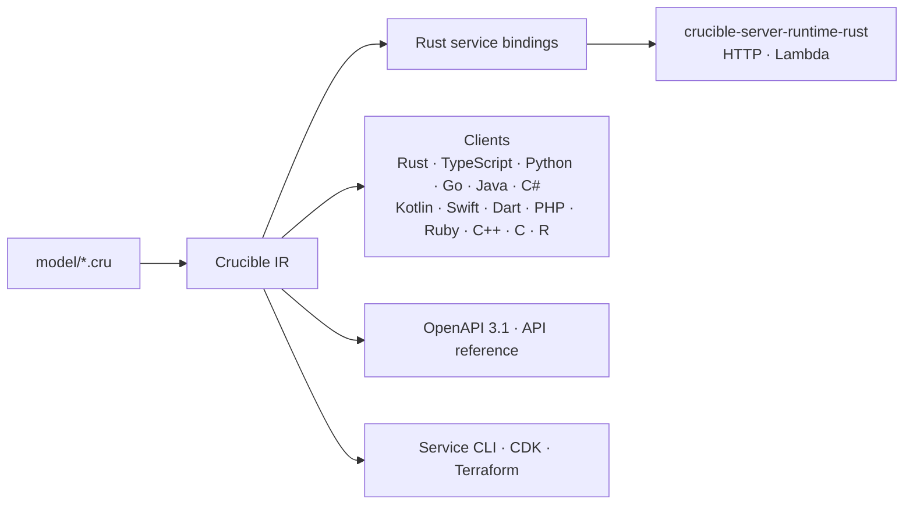

# Crucible

[](https://github.com/Operation-Leyline/crucible/actions/workflows/ci.yml)
[](https://github.com/Operation-Leyline/crucible/releases)
[](LICENSE)

**A contract-first API framework.** Describe your API once in a `.cru` model,
implement it on a fast Rust server runtime, and generate native clients in 14
languages, OpenAPI, reference docs, a service CLI, and infrastructure packages
from the same contract.



Every generator reads the same lowered model, so nullability, constraints, HTTP
bindings, errors, pagination and timestamp formats mean the same thing on the
server and in every client.

## What it looks like

A model:

```
/// A greeting service.
service HelloService {
    version "1"
    protocol json
    operations [SayHello]
    errors [ValidationException, InternalServerException, UnknownOperationException]
}

/// Return a greeting for the supplied name.
operation SayHello {
    http POST "/hello" -> 200

    input {
        name: string { length 1.. }
    }

    output {
        message: string
    }
}
```

The handler you write. Input is already deserialized and validated; an empty
`name` never reaches it and the caller gets a modeled `ValidationException`
(HTTP 400):

```rust
impl SayHelloOperation for Service {
    async fn say_hello(&self, input: SayHelloInput) -> Result<SayHelloOutput> {
        Ok(SayHelloOutput {
            message: format!("Hello, {}!", input.name),
        })
    }
}
```

And the host:

```rust
crucible_server_runtime_rust::include_service!();

let service = Crucible::builder(hello_service::operations(Arc::new(Service)))
    .protocol(JsonProtocol)
    .build()?;
crucible_server_runtime_rust::host::http_on(service, listener).await
```

Generation runs in `build.rs`, so editing the model and running `cargo build`
is the whole loop. Rename an output member and the compiler points at the
handler that needs to change.

## Features

- **The Crucible language.** Services, resources with lifecycle roles,
  operations, structures, unions, enums, modeled errors, defaults, constraints,
  pagination, idempotency tokens, examples and custom metadata, with
  diagnostics that list every problem in one run.
  [Language reference](docs/idl/reference.md)
- **A Rust server framework.** A phased request pipeline, validation, error
  translation, structured logging, metrics, deadlines, middleware and typed
  interceptors, page tokens, idempotency receipts, typed permissions, and
  bearer/JWT/API-key auth. Hosts on HTTP or AWS Lambda.
  [Framework guide](docs/framework.md)
- **Idiomatic clients.** Public clients carry your service's name
  (`WeatherClient`), take native values and collections, and ship with a
  bundled runtime for transport, retries, auth and pagination.
  [Clients](#clients)
- **More from the same model.** OpenAPI 3.1, a human-readable API reference,
  a standalone service CLI, AWS CDK constructs, a Terraform/OpenTofu provider,
  an MCP endpoint, and a local API explorer.
- **API governance.** Build-time naming and documentation rules in
  `crucible.toml`, `crucible diff` for breaking-change checks in CI, and frozen
  API releases with per-version clients.
  [API policy](docs/api-policy.md) · [API versions](docs/api-versions.md)
- **Editor support.** `crucible-lsp` gives `.cru` files and `crucible.toml`
  diagnostics, completion, navigation, rename, formatting and quick fixes.

## Quick start

You need [Rust](https://rustup.rs) 1.85 or newer. Cargo fetches Crucible
itself; there is no CLI, JVM or runtime to install first.

**Start from the template.** The
[Crucible service template](https://github.com/Operation-Leyline/crucible-service-template)
is a complete project: a `.cru` model with a frozen release and compatibility
checks, a Rust service with working handlers for an `Item` resource, generated
Rust and Java SDKs with independent client apps, and CI workflows. Select
**[Use this template](https://github.com/Operation-Leyline/crucible-service-template/generate)**
on GitHub, or:

```sh
gh repo create my-api --template Operation-Leyline/crucible-service-template --clone
cd my-api
cargo run
# Listening on http://127.0.0.1:8080
```

Then send the requests in `service/requests.http` from your IDE. The
template's README covers the layout, the clients and how to grow the model.

**Start smaller.** For a single-crate hello-world service, download
`hello-service-v<version>.zip` from the
[latest release](https://github.com/Operation-Leyline/crucible/releases/latest)
and follow the [quick start](docs/quickstart.md). Its whole build script is:

```rust
fn main() {
    crucible_build::model("model").server()
        .policy("crucible.toml")
        .generate();
}
```

**Install the CLI** to scaffold packages and generate non-Rust clients. Install
it from a release tag; it is not published to crates.io, where `crucible-cli`
is an unrelated crate:

```sh
cargo install --git https://github.com/Operation-Leyline/crucible --tag v0.7.0 crucible-cli --locked

crucible new my-service              # a single-crate Rust service
crucible new my-client --client      # a Rust client library
crucible check model                 # compile and check a model package
```

## Clients

Generate a client from a model package (a directory with a `crucible.toml`
beside the `.cru` sources):

```sh
crucible check model --target ts
crucible generate ts model \
  --out generated/weather --package-name @example/weather \
  --endpoint https://api.example.com
```

`crucible generate <language> --help` lists each target's options. Generation
records the files it owns, keeps handwritten files, and removes obsolete ones,
so regenerating is always safe.

| Language | Generated package | Guide |
|---|---|---|
| Rust | Cargo SDK with its runtime dependency | [Rust](docs/clients/rust.md) |
| TypeScript / JavaScript | Fetch-based ESM package, no dependencies | [TypeScript](docs/clients/typescript.md) |
| Python | HTTPX package with sync and async clients | [Python](docs/clients/python.md) |
| Go | Go module using `net/http` | [Go](docs/clients/go.md) |
| Java | Java 17 Gradle / Maven package | [Java](docs/clients/java.md) |
| C# | .NET 8 NuGet project | [C#](docs/clients/csharp.md) |
| Kotlin | JVM / Android package with coroutines | [Kotlin](docs/clients/kotlin.md) |
| Swift | Swift package for Linux and Apple platforms | [Swift](docs/clients/swift.md) |
| Dart | Native VM and browser package | [Dart](docs/clients/dart.md) |
| PHP | Composer package | [PHP](docs/clients/php.md) |
| Ruby | Ruby gem | [Ruby](docs/clients/ruby.md) |
| C++ | C++20 CMake package | [C++](docs/clients/cpp.md) |
| C | C17 CMake package | [C](docs/clients/c.md) |
| R | R source package | [R](docs/clients/r.md) |

[Client setup and conformance](docs/clients.md) covers model preparation and
the shared retry contract; [build outputs](docs/build-outputs.md) covers
producing several named SDKs from one workspace, and
[SDK packaging](docs/sdk-packaging.md) covers publishing them.

## Other outputs

| Output | Command | Guide |
|---|---|---|
| OpenAPI 3.1 | `crucible generate openapi` | [OpenAPI](docs/openapi.md) |
| API reference (mdBook) | `crucible generate docs` | [Reference docs](docs/docs.md) |
| Service CLI | `crucible generate cli` | [Service CLI](docs/clients/cli.md) |
| AWS CDK constructs | `crucible generate cdk` | [Infrastructure](docs/infrastructure.md) |
| Terraform / OpenTofu provider | `crucible generate terraform` | [Infrastructure](docs/infrastructure.md) |
| MCP tools on your service | `.mcp()` in `build.rs` | [MCP](docs/mcp.md) |
| Local API explorer | `.explorer()` in `build.rs` | [Explorer](docs/explorer.md) |

## Documentation

| Start here | |
|---|---|
| [Quick start](docs/quickstart.md) | Your first service, end to end |
| [Framework guide](docs/framework.md) | Architecture, request lifecycle, service layout, middleware recipes, testing, hosting |
| [Language reference](docs/idl/reference.md) | The `.cru` grammar, checks, permissions and policy rules |
| [Design and protocol](docs/design.md) | The model-to-IR pipeline and the Crucible JSON wire rules |
| [Authentication](docs/auth.md) · [Permissions](docs/permissions.md) · [Idempotency](docs/idempotency-receipts.md) | Built-in security and reliability features |
| [API versions](docs/api-versions.md) | Frozen releases, compatibility guards and versioned clients |
| [Stability](docs/stability.md) · [Migrating](docs/migrating.md) · [Changelog](CHANGELOG.md) | What is stable and how to upgrade |

The [weather example](e2e/) is a complete model, service and client tested over
HTTP, laid out the way the framework guide recommends.

## Status

Crucible is `0.x`. Patch releases never break the
[documented stable surface](docs/stability.md); a minor release may, but only
with a [migration](docs/migrating.md) entry and, for most changes, a
`#[deprecated]` shim kept for one minor. See the
[stability policy](docs/releases.md#stability-policy-for-0x). Pin the runtime
and `crucible-build` to the same release and upgrade them together.

Crucible's crates are not yet on crates.io; services depend on this repository by git,
which `crucible new` sets up for you.

## Contributing

Issues and pull requests are welcome. Before changing code, read
[`AGENTS.md`](AGENTS.md) for crate boundaries, conventions and the full test
commands, and [`docs/framework.md`](docs/framework.md) or
[`docs/design.md`](docs/design.md) for the area you are touching.

```sh
cargo fmt --all
cargo clippy --all-targets -- -D warnings
cargo test
CRUCIBLE_BLESS=1 cargo test   # rewrite golden files after an intended output change
```

Generated output is checked in under `crates/*/tests/golden/`, so a generator
change shows up as a golden diff for review. Changes to the stable surface need
a [`CHANGELOG.md`](CHANGELOG.md) entry. Release procedure is in
[docs/releases.md](docs/releases.md).

## License

Crucible is licensed under the [Apache License, Version 2.0](LICENSE).
