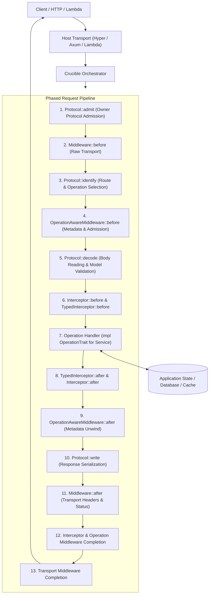
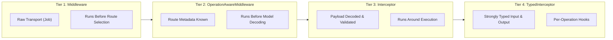
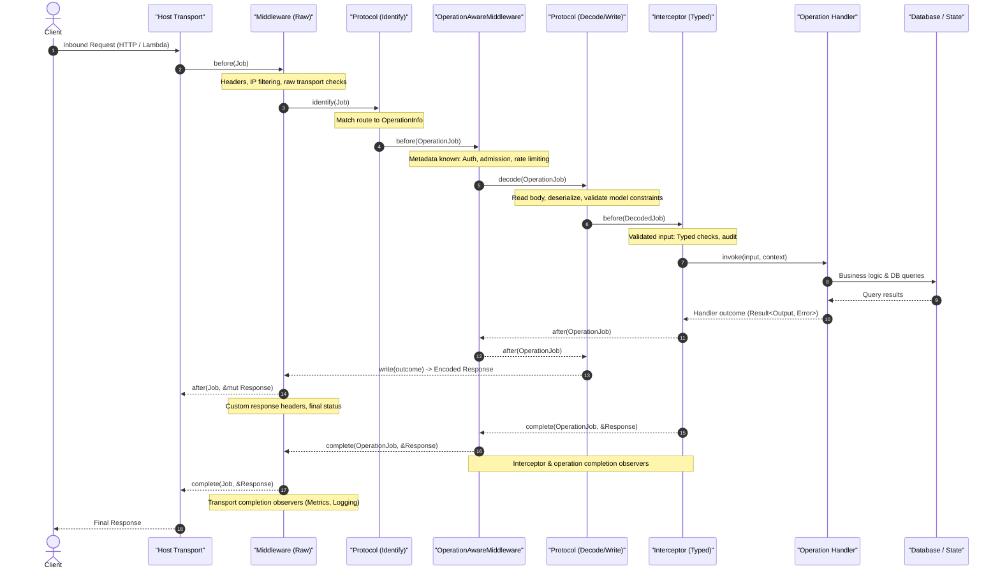

# The Crucible framework

The documented service-author API and generated-code version boundary are
described in [Rust runtime stability](stability.md).

Crucible is two products:

1. **The framework** (`crucible-server-runtime-rust` crate): everything a service does that is not
   specific to its API. That covers the request pipeline (an orchestrator
   running a phased pipeline), the request context, protocols, validation, the
   error model, the service log, metrics plumbing and transports. A service
   depends on it like any library.
2. **The model adaptor** (`crucible-lang` + `crucible-codegen-rust`, run by
   `crucible-build`): reads a model and generates the API-specific code that
   plugs into the framework. That is the types, an interface per operation,
   and the operation registry.

```
weather-model/      model package: `.cru` sources and crucible.toml
weather-service/    service package
  Cargo.toml          [dependencies] crucible-server-runtime-rust, weather-model   [build-dependencies] crucible-build
  build.rs            crucible_build::model("weather_model").server().generate()
  src/                impl GetCityOperation for Weather { ... }   Crucible::builder()...
```

## Table of Contents

- [Architecture & Request Lifecycle](#architecture--request-lifecycle)
  - [The Four Extensibility Tiers](#the-four-extensibility-tiers)
- [Start with one crate](#start-with-one-crate)
- [Opinionated Service Layout & Design](#opinionated-service-layout--design)
  - [Directory Structure](#directory-structure)
  - [Dependency Injection & Shared State](#dependency-injection--shared-state)
  - [Implementing Operation Handlers](#implementing-operation-handlers)
- [The request context](#the-request-context)
  - [Deadlines](#deadlines)
- [The request pipeline](#the-request-pipeline)
  - [Execution Lifecycle & Error Unwinding](#execution-lifecycle--error-unwinding)
- [Writing Custom Middleware (Recipes)](#writing-custom-middleware-recipes)
  - [Extension helpers](#extension-helpers)
  - [Bodies and responses](#bodies-and-responses)
  - [Pagination tokens](#pagination-tokens)
  - [Idempotency tokens](#idempotency-tokens)
  - [Typed permissions](#typed-permissions)
- [Protocols](#protocols)
  - [Model-driven authentication](#model-driven-authentication)
- [Errors](#errors)
- [The service log](#the-service-log)
- [Metrics](#metrics)
- [Hosting](#hosting)
  - [Local API explorer](#local-api-explorer)
  - [Host selection](#host-selection)
- [Model Context Protocol](#model-context-protocol)
- [Testing Strategies](#testing-strategies)
  - [Unit Testing Operation Handlers Directly](#1-unit-testing-operation-handlers-directly)
  - [In-Process Pipeline Testing with invoke](#2-in-process-pipeline-testing-with-invoke)
  - [In-Process HTTP Testing with handle](#3-in-process-http-testing-with-handle)
- [Clients](#clients)
- [Performance](#performance)

---

## Architecture & Request Lifecycle

Crucible is built around a zero-cost, contract-first design:
- **Contract-first:** Your API is specified in `.cru`. The compiler lowers this contract to an immutable Intermediate Representation (IR), validating types, constraints, HTTP bindings, and version compatibility before any code is generated.
- **Compiled, thin runtime:** The code generator produces pure Rust traits, data structs, and `'static` operation descriptions. No dynamic reflection, runtime routing tables, or per-request string parsing.
- **Phased pipeline:** Every inbound request flows through an orchestrated pipeline with strictly ordered phases. Each phase provides exact guarantees about what data has been inspected, decoded, or validated.



### The Four Extensibility Tiers

Crucible provides four specialized extension tiers, allowing you to hook into requests at exactly the right level of abstraction:



| Tier | Trait | Before View | After View | Typical Uses |
|---|---|---|---|---|
| **1. Transport** | `Middleware` | `&mut Job` (raw request, operation unknown) | `&mut Job`, `&mut Response` (encoded bytes) | TLS enforcement, CORS, custom response headers, IP allowlists |
| **2. Route Policy** | `OperationAwareMiddleware` | `&mut OperationJob` (operation metadata known, before model decoding/validation) | `&mut OperationJob` (outcome available) | Header authentication, rate limiting, route admission, tenant checks |
| **3. Invocation** | `Interceptor` | `&mut DecodedJob` (validated input guaranteed) | `&mut OperationJob` (outcome available) | Cross-cutting audit logging, payload encryption, outcome transforms |
| **4. Typed Hook** | `TypedInterceptor<O>` | `&O::Input`, `&Context` (strongly typed) | `Option<&O::Output>`, `&Context` | Caching operation outputs, operation-specific business metrics |

---

## Start with one crate

Generate server models and bindings inside the service crate. Add `crucible-server-runtime-rust`
as a normal dependency and `crucible-build` as a build dependency, pinned to the
same revision. Hand wiring needs two hooks:

```rust
// build.rs
fn main() {
    crucible_build::model("model").server().generate();
}
```

```rust
// src/main.rs or src/lib.rs
crucible_server_runtime_rust::include_service!();
```

For `service Weather`, the inclusion hook declares `pub mod weather`.
Models, enums, exceptions, operation markers and traits are available directly:

```rust
use crate::weather::{GetCityInput, GetCityOutput, GetCityOperation, NotFoundError};
use crucible_server_runtime_rust::Result;
```

A string enum is a closed Rust enum with `as_str()` and `VALUES`, the wire values in
declaration order. There is no wrapper module to create. The source path is relative to this
crate's manifest; it can also point outside the crate, such as
`../model`. With a published model dependency, replace the build call
with `crucible_build::model("weather_model").server().generate()`; inclusion is the
same, and the model is not compiled again.

The helper compiles the package, watches the model, and writes the compiled
model and generated bindings under `OUT_DIR`. The
inclusion macro makes those types visible to Rust without exposing the output
filename or writing generated code into the source tree. The
[single-crate quick start](quickstart.md) has a complete runnable service.

The starter declares `crucible.errors#ValidationException` (HTTP 400),
`crucible.errors#InternalServerException` (HTTP 500), and
`crucible.errors#UnknownOperationException` (HTTP 404) as service errors. The high-level
helper diagnoses an unfillable or missing validation error before startup.
Advanced services that supply their own `on_rejection` handler can call
`.custom_rejections()`. Existing JSON-AST build helpers retain that advanced
behavior.

## Model packages

Services and clients can select `crucible.toml` with `.policy("crucible.toml")`
on the build helper. API conventions run after model lowering and before
generation. Config changes trigger another Cargo build check. Compatibility is
a separate old/new contract comparison in CI. See
[API policy and compatibility](api-policy.md).

A model package is a Cargo crate with `links = "<name>"` holding shared `.cru`
sources. Its build script compiles and publishes the model with:

```rust
fn main() {
    crucible_build::model("model").publish();
}
```

The helper compiles the package and keeps a stable compiled model under
`OUT_DIR`. The service and client depend
on this package and read it from `DEP_<NAME>_MODEL`, using
`crucible_build::model("<name>").server()` or `crucible_build::model("<name>").client()`.
"This service depends on weather-model 1.4" is an ordinary, version-pinned
Cargo dependency.

For model-owned Rust and Java SDK outputs, compile once with
`crucible_build::model("model")`, publish the model, and add a
named generation call per SDK variant. Another package can generate from
`crucible_build::model("<links>")` without compiling the package again.
See [building named SDK packages](build-outputs.md) for feature selection, native
package export, and direct service/SDK integration.

## Generated code

`crucible_build::model(..).server().generate()` writes one file into `OUT_DIR`; the service
includes it with `crucible_server_runtime_rust::include_service!()`. Per operation `GetGraph` it
generates:

```rust
pub struct GetGraph;                         // identity: impl crucible_server_runtime_rust::Operation
impl Operation for GetGraph {
    const INFO: &'static OperationInfo = &...; // name, resource, http binding, errors, traits
    type Input = GetGraphInput;
    type Output = GetGraphOutput;
}

pub trait GetGraphOperation: crucible_server_runtime_rust::WithContext {
    fn get_graph(&self, input: GetGraphInput) -> impl Future<Output = crucible_server_runtime_rust::Result<GetGraphOutput>> + Send;
}
```

The service normally owns this build script and includes the service namespace at its crate
root. A separate contract crate is optional when multiple
Rust crates need to share the generated server API. A reusable Rust SDK package
can own client inclusion so applications import its service-named client.
The [named SDK guide](build-outputs.md#consuming-the-rust-sdk-and-service-contract)
shows how to wire both directly by hand.

The service implements the trait. Grouping is free: one type can implement
every operation, or one type per resource.

```rust
use crate::operations::Weather;
use crate::weather::{GetCityInput, GetCityOperation, GetCityOutput, NotFoundError};
use crucible_server_runtime_rust::Result;

impl GetCityOperation for Weather {
    async fn get_city(&self, input: GetCityInput) -> Result<GetCityOutput> {
        let caller = self.context().attribute::<Principal>();
        let city = self.cities.get(&input.city_id).await?;          // any error: `?`
        let city = city.ok_or_else(|| NotFoundError {
            message: "no such city".into(),
            resource_id: Some(input.city_id),
        })?;
        Ok(GetCityOutput {
            city,
            forecast: None,
            request_id: None,
        })
    }
}
```

Registration is checked at compile time: the generated
`operations(service: Arc<T>)` requires `T` to implement every operation
trait. For split implementations, the generated module-level `builder()` API
(e.g. `weather::builder()`) takes one operation at a time and `build()` names the missing ones.

Types are generated with serde and `Validate`. Errors implement
`crucible_server_runtime_rust::ModelledError` (wire name, status, fault). None of it is
protocol-specific: bindings (label, query, header, body, payload) are data
in `OperationInfo`, read by whichever protocol serves the request.

A `blob` is `crucible_server_runtime_rust::Blob`, which holds `bytes::Bytes`: base64 in
a JSON body, its byte count checked by `@length`. An `@httpPayload` blob is
the request body itself, and its `Blob` shares the body's buffer rather than
copying it.

## Model Context Protocol

Generate static public tool descriptions with `.mcp()` on the service build
helper, then opt in at runtime with
`.mcp(McpConfig::new())` on the service builder. MCP serves
the descriptors carried by generated `SERVICE.mcp_tools`; runtime setup does
not pass the descriptor constant separately. It handles
stateless JSON-RPC requests on `/mcp` alongside the modeled protocols. Tool calls
enter the normal operation pipeline; endpoint guards also protect initialization
and discovery. HTTP authentication refusals preserve their status and challenge.

Descriptors use the External audience projection and share JSON Schema emission
with OpenAPI. Outputs are
checked against their advertised schemas before publication. See
[serving MCP](mcp.md) for configuration, agent connections, Origin rules,
authentication hooks, and transport limits.

## Internal operations

Servers implement all operations regardless of client audience. Generated static
`OperationInfo::internal` records the `@internal` annotation. An application's
`OperationAwareMiddleware::before` can check `job.operation().internal` together
with an authenticated principal in `job.context()` and reject external callers.
The framework supplies metadata and extension interfaces; caller policy belongs
to the service. Client filtering does not secure a server endpoint.

The [audience integration test](../e2e/weather-service/tests/audience.rs) demonstrates
rejecting an external caller while allowing an internal caller to reach the same
operation. Its example header is only a test caller marker; production services
should use their authenticated principal.

## Opinionated Service Layout & Design

Crucible enforces a clean, modular structure where operations and extensions are organized like Java packages: one type per file, named for what it holds.

### Directory Structure

```text
src/
  lib.rs or main.rs       // include_service!() declares the API module; boots HTTP/Lambda
  state.rs                // Shared application state (DB connection pools, clients)
  operations/
    mod.rs                // The service struct and what operations share
    service/              // Operations bound directly to the service
      get_status.rs       // impl GetStatusOperation for Service
    city/                 // One sub-folder per modeled resource (in snake_case)
      mod.rs              // Shared helpers for city operations
      get_city.rs         // impl GetCityOperation for Service
      create_city.rs      // impl CreateCityOperation for Service
  middlewares/
    mod.rs                // pub use auth::BearerAuth; ...
    auth.rs               // Custom transport or operation middleware
    headers.rs            // Security and custom header middleware
  interceptors/
    mod.rs                // pub use audit::AuditLog; ...
    audit.rs              // Typed invocation interceptors
  store/
    mod.rs                // Database and storage repository traits & adapters
```

`crucible scaffold <package-dir>` inspects your compiled `.cru` model and automatically creates stubs for all un-implemented operations in their respective resource folders, adding missing `mod` statements without overwriting existing code.

### Dependency Injection & Shared State

A Crucible service struct holds long-lived dependencies (database connection pools, cache clients, external HTTP clients), **never per-request data**. Because `&self` is shared across concurrent requests, your service struct should wrap its state in `Arc<T>`:

```rust
use std::sync::Arc;

pub struct AppState {
    pub db: sqlx::PgPool,
    pub cache: redis::aio::ConnectionManager,
    pub config: AppConfig,
}

pub struct WeatherService {
    state: Arc<AppState>,
}

impl WeatherService {
    pub fn new(state: Arc<AppState>) -> Self {
        Self { state }
    }
}
```

When building the server, pass your service instance wrapped in `Arc::new(service)` to `weather::operations(...)`:

```rust
let state = Arc::new(AppState { db, cache, config });
let service = Arc::new(WeatherService::new(state));

let crucible = Crucible::builder(weather::operations(service))
    .middleware(ServiceLog::default())
    .protocol(JsonProtocol)
    .build()?;
```

### Implementing Operation Handlers

Each operation file contains exactly one trait implementation. Handlers are asynchronous, take their generated input struct by value, and return `Result<Output>`:

```rust
use crate::operations::WeatherService;
use crate::weather::{GetCityInput, GetCityOperation, GetCityOutput, NotFoundError};
use crucible_server_runtime_rust::Result;

impl GetCityOperation for WeatherService {
    async fn get_city(&self, input: GetCityInput) -> Result<GetCityOutput> {
        // 1. Read request context attributes (e.g. caller identity)
        let caller = self.context().attribute::<Principal>();
        let request_id = self.context().request_id();

        // 2. Query application storage via shared state
        let row = sqlx::query_as!(CityRecord, "SELECT name, temp FROM cities WHERE id = $1", input.city_id)
            .fetch_optional(&self.state.db)
            .await?;

        // 3. Return modeled error if not found
        let record = row.ok_or_else(|| NotFoundError {
            message: format!("City '{}' was not found", input.city_id),
            resource_id: Some(input.city_id),
        })?;

        // 4. Return generated output
        Ok(GetCityOutput {
            city: record.into(),
            forecast: None,
            request_id: Some(request_id.to_string()),
        })
    }
}
```

> [!TIP]
> Grouping is flexible: a single struct can implement every operation in the service, or you can split operations across separate structs using the generated module-level operations builder (e.g. `weather::builder()`). If any operation lacks an implementation at build time, the Rust compiler fails with an explicit list of missing operations.

## The request context

`self.context()` inside an implementation, or `crucible_server_runtime_rust::Context::current()`
anywhere on the request's task, returns the request context. It holds the
request id, the operation's `OperationInfo`, the deadline, request headers,
and typed attributes that extensions set (an authenticated principal, say).
It reads like a field of the implementing type, but `&self` is shared by concurrent
requests, so it is a task-local the orchestrator sets around the call.
**Decision:** a task spawned inside an implementation does not inherit it;
`context.scope(future)` carries it across, together with the request tracing span
and subscriber. The span records `request_id` and `operation`, so application
events emitted through `tracing` carry the same request context.

The request id comes from `Builder::request_id(source)` when the service
names one (an inbound header behind a trusted edge), else from the host, else
it is a fresh UUID; an id that is empty or over 128 bytes is replaced. On
Lambda the host supplies an HTTP event's own request id, or the invocation's
id for a direct invoke, and the invocation deadline. Hosts pass both through a
`RequestMeta` request extension.

### Deadlines

The framework enforces a request's deadline: the host's, less
`DEADLINE_RESERVE` (250 ms), or `Builder::request_timeout(duration)` after
arrival, whichever comes first. Past it, the phase running is dropped (the
operation's future included, as if it panicked), the phases already entered
unwind, and the request fails with `DeadlineExceeded`. That error meets the
exception rules like any other. Unmatched, the caller gets the service's
internal error, and a `ServiceLog` with failure logging enabled records the
cause, as for any internal failure. An exception rule can
answer a modelled error instead, such as a 503. `context.deadline()` reports
the enforced deadline, so extensions and implementations can budget work
against it. Changing it with `set_deadline` changes what they read, not when
the framework stops the request.

Set `request_timeout` below whatever waits in front of the service.
CloudFront's origin response timeout is 30 s by default, and a Lambda
function's own timeout is often longer. Without a budget, CloudFront returns
504 while the function runs on, billed, and logs an answer nobody receives.
The after phases and the response are not under the deadline: they are what
the reserve is for. Work an implementation spawned is not stopped; give
it its own timeout from `context.deadline()`.

## The request pipeline

The orchestrator strictly enforces phase order. Registration order matters within each phase; protocols are negotiated based on capabilities rather than placed arbitrarily.



### Execution Lifecycle & Error Unwinding

1. **Forward Execution (`before`):** Runs through the forward extension phases in order (transport middleware, route policy middleware, and invocation interceptors). If any `before` hook returns an `Err(Error)`, forward execution stops immediately.
2. **Reverse Unwinding (`after`):** Only hooks whose `before` succeeded unwind, in strict reverse order within their respective phases (`Interceptor::after`, then `OperationAwareMiddleware::after`, followed by `Protocol::write`, and finally `Middleware::after`).
3. **Short-circuiting (`respond`):** Extensions receiving a mutable job (`Job`, `OperationJob`, or `DecodedJob`) can immediately complete the request by calling `job.respond(response)`. (Typed interceptors do not receive a mutable job and reject requests by returning `Err(Error)` instead). Later forward phases are skipped, and prior `before` hooks unwind cleanly.
4. **Error Sanitization:** All errors (whether thrown by handlers, deserializers, or middleware) are normalized through registered `ExceptionTranslator` rules before being serialized into standard wire errors.

---

## Writing Custom Middleware (Recipes)

### Recipe 1: Bearer Token Authentication (`OperationAwareMiddleware`)

When authenticating requests, you typically want to know which operation is being called so you can skip authentication for public operations:

```rust
use crucible_server_runtime_rust::{
    Error, FrameworkError, Hook, OperationAwareMiddleware, OperationJob, Result,
};

#[derive(Clone, Debug)]
pub struct Principal {
    pub subject: String,
    pub scopes: Vec<String>,
}

pub struct BearerAuth;

impl OperationAwareMiddleware for BearerAuth {
    fn before<'a>(&'a self, job: &'a mut OperationJob<'_>) -> Hook<'a, Result<()>> {
        // Skip auth if operation is marked with @public
        if job.metadata().public {
            return Hook::Ready(Ok(()));
        }

        let auth_header = job
            .request()
            .headers
            .get("authorization")
            .and_then(|h| h.to_str().ok());

        match auth_header {
            Some(header) if header.starts_with("Bearer ") => {
                let _token = &header["Bearer ".len()..];
                // In a real service, decode and verify your JWT here:
                let principal = Principal {
                    subject: "user_12345".into(),
                    scopes: vec!["read".into(), "write".into()],
                };
                // Store on task-local request context:
                job.context().set_attribute(principal);
                Hook::Ready(Ok(()))
            }
            _ => Hook::Ready(Err(Error::new(FrameworkError::Unauthenticated))),
        }
    }
}
```

### Recipe 2: Operation-Specific Hook (`TypedInterceptor<O>`)

To inspect or mutate the strongly-typed input and output of a specific operation (e.g. logging metrics or cache invalidation):

```rust
use crucible_server_runtime_rust::interceptors::TypedInterceptor;
use crucible_server_runtime_rust::{Context, Result};
use crate::weather::{GetCity, GetCityInput, GetCityOutput};

pub struct CityMetricsInterceptor;

#[crucible_server_runtime_rust::async_trait]
impl TypedInterceptor<GetCity> for CityMetricsInterceptor {
    async fn before(&self, input: &GetCityInput, _context: &Context) -> Result<()> {
        tracing::debug!(city_id = %input.city_id, "Looking up city weather");
        Ok(())
    }

    async fn after(&self, output: Option<&GetCityOutput>, _context: &Context) {
        if let Some(out) = output {
            tracing::info!(city = %out.city.name, "Successfully resolved city weather");
        }
    }
}
```

Register it on the service builder using `for_operation`:

```rust
Crucible::builder(weather::operations(service))
    .interceptor(crucible_server_runtime_rust::interceptors::for_operation(CityMetricsInterceptor))
    .build()?;
```

### Recipe 3: Custom Response Headers (`Middleware`)

To set security headers (HSTS, CSP) or correlation IDs on every outgoing HTTP response:

```rust
use crucible_server_runtime_rust::{Hook, Job, Middleware};
use axum::response::Response;
use axum::http::HeaderValue;

pub struct SecurityHeaders;

impl Middleware for SecurityHeaders {
    fn after<'a>(&'a self, _job: &'a mut Job, response: &'a mut Response) -> Hook<'a, ()> {
        let headers = response.headers_mut();
        headers.insert("x-content-type-options", HeaderValue::from_static("nosniff"));
        headers.insert("x-frame-options", HeaderValue::from_static("DENY"));
        Hook::Ready(())
    }
}
```

### Extension helpers

- `OperationMiddlewareExt`, `InterceptorExt`, and `ProtocolExt` provide
  `.only`, `.except`, `.when`, and `.when_trait`. Raw middleware can inspect
  headers before identification; operation scoping belongs to later stages.
  Nested scopes only narrow `prepare.operations()`,
  `prepare.served_operations()` and request selection.
- `before_fn` and `after_fn` construct synchronous operation-aware middleware;
  `raw_before_fn` constructs a synchronous transport check.
- `for_operation` adapts `TypedInterceptor<O>` to the interceptor registry.
  It skips other operations and prepares only for its named operation.
- Libraries can ship separate bundles of boxed middleware, operation-aware
  middleware, interceptors and protocols through the matching plural builder
  methods. A bundle retains the phase guarantees.
- Every extension can read model traits once in `prepare`. Invalid required
  configuration fails service construction. `prepare.service()` exposes the
  whole model; `prepare.operations()` exposes only its scope, each operation
  id once. `prepare.served_operations()` lists the same scope per API
  version: one `ServedOperation` per entry, with the description a request
  at that version carries and the metadata it is served with. Prepare what
  an older release may declare differently (authentication schemes and
  flags) per entry, and select it per request by
  `std::ptr::eq(served.operation(), job.operation())`, not by id: the
  authenticator chain does.

### Bodies and responses

`Job::body()` and `OperationJob::body()` are empty until `read_body()` or the
selected protocol reads the body. A transport policy needing buffered bytes
must explicitly await `read_body()`. Header-only admission need not wait for
a client to send its body. Reads are idempotent, including rejected or cancelled
reads. The service-wide limit applies before selection; a smaller selected
operation limit also rejects previously buffered bytes.

Native transport `after` hooks receive the encoded response and can change its
headers, status, or body, including wrapping its stream. `complete` observers
run after all native response transformations and cannot change the response.
Completion means response ready, not successful delivery or body exhaustion.
Cancellation drops request work; hooks are not guaranteed to run when their
future is dropped. Failures after headers cannot replace the answer;
body wrappers can observe end, error, and drop for delivery-specific metering.

`Builder::tower_layer` is an explicit compatibility adapter for existing Tower
middleware, outside the native pipeline and on every host. It can reuse CORS,
compression, around-future task scopes, and similar transport machinery. The
first adapter added is outermost. Its errors must be answered by that adapter,
and its transformations/body delivery happen after native completion observers.
A service can implement response transforms entirely through Crucible
middleware. Request heads are read-only through `Job`; use the adapter
for request-header, URI, or body rewriting. In transport `after`, modify the
provided response directly: staging job headers, errors, or `respond` there
occurs after encoding. Tower is not required for application extension interfaces.


A service whose `.cru` model has migrations also serves older API
versions ([api-versions.md](api-versions.md)). After the raw middleware
runs, the request's version is settled from its `Crucible-Version`
header, so routing and decoding use that version's operations. After
decoding, an older version's input is converted to the current one, so
interceptors and the handler see only current types. Before encoding,
after the interceptors' and operation middleware's `after` phases, the
output or error is converted back.

### Pagination tokens

A `@paginated` operation hands its caller a token saying where the listing
resumes. Whatever the service keeps there (a DynamoDB `LastEvaluatedKey`, an
offset) should not reach the caller as it is: a readable token can be edited,
replayed against another listing or caller, or kept forever. The
`page-tokens` feature seals it instead. It needs no store and no network
call: a token is checked by opening it.

```toml
crucible-server-runtime-rust = { version = "=0.7.0", features = ["page-tokens"] }
```

```rust
use crucible_server_runtime_rust::page_tokens::{PageKeys, PageTokens};

// Any secret of 32 bytes or more, from wherever the service keeps secrets.
let keys = PageKeys::new("k1", secret.as_bytes())?;
let builder = builder.interceptor(PageTokens::new(
    keys,
    // Who is asking, so one caller's token does not open for another:
    // the principal's issuer, subject and tenant, as a JSON array.
    crucible_auth::Principal::caller_binding_of,
));
```

The caller binding is the same for `PageTokens` and `Idempotency`: see
[Binding a token to its caller](#binding-a-token-to-its-caller). The
operation keeps its own cursor bytes and never sees a token:

```rust
let start = page_tokens::resume()?; // the cursor the request's token sealed; None on the first page
let (items, last) = store.page(start.as_deref(), size).await?;
let next_token = last.map(|key| page_tokens::issue(&key)).transpose()?;
```

- **Sealed.** XChaCha20-Poly1305 with a random nonce per token, under a key
  derived from the secret with HKDF-SHA256. A caller can neither read the
  cursor nor change a byte of the token.
- **Bound to the request.** The seal covers a digest of the service, the
  operation, the caller and the decoded input without its token and page
  size. A token opens only for the same caller, listing and filters,
  whichever protocol or binding carried them. The page size may change
  between pages.
- **Expiring.** The expiry is sealed inside: 24 hours, or
  `PageTokens::ttl`, from one second to 30 days in whole seconds (`build`
  refuses any other). A change applies to tokens issued after it, so
  lowering it revokes nothing already issued.
- **Rotatable.** A token names its key. `PageKeys::accept` keeps a retired
  key opening the tokens it sealed while the current key seals new ones;
  drop it after one token lifetime. Rotating means a new secret: a key
  whose secret another key already uses is refused (`ReusedSecret`), since
  it would be the same key under a new name. Dropping a key is the only way
  to revoke the tokens it sealed. The secret must be random (32 bytes from
  a CSPRNG), not a password: its length is checked, its randomness cannot
  be.
- **Bounded.** A cursor is at most 4096 bytes by default (`issue` of a longer
  one is an internal error; `PageTokens::max_cursor` lowers it), and a token
  longer than the longest one `issue` writes is refused before it is decoded.
  The longest token is `4 + len(key id) + ceil(4 * (48 + max_cursor) / 3)`
  characters (`PageTokens::max_token_length`): 5532 for a 2-character key id
  and the default cap. `build` refuses a paginated operation whose input
  token member's `@length` max is smaller than that, naming the operation, the
  two lengths and the largest cursor that fits
  (`PageTokens::cursor_capacity(limit)`), so a model limit is met at build and
  not by a long cursor at runtime. A model with `@length(max: 2048)` on its
  token: `let tokens = PageTokens::new(..); let tokens = tokens.max_cursor(tokens.cursor_capacity(2048)?);`
  (1483 bytes for a 2-character key id). A token member with no `@length`
  accepts any cap. The check reads the input token (`Pagination::input_token_max_length`),
  so give the output's `nextToken` the same shape.

The interceptor opens the request's token before the operation runs; with
typed permissions, register it after `Permissions`, so a refused request is
refused before its token is opened (the other order fails the build). A token
that does not open, whatever the reason, is the service's validation error
naming the token member (`fieldValidationFailed`), never echoing the token.
`PageTokens::refusal` builds a different error, for a service with a reason
of its own. Operations that are not `@paginated` pass through untouched;
`resume` and `issue` called from one are an internal error. The generated
`Operation::PAGINATION` (on `OperationMetadata::pagination`) names the
token and page size members it reads, and says whether the token is a map:
A model may declare one, but a sealed token is a string, so `build` refuses
`PageTokens` for an operation whose token is a map (leave it out of the
interceptor's scope). At an older API version the interceptor reads the
current version's input, so the members are the current ones: a token a
migration renamed still resumes the listing, and a version from before the
operation was paginated gets its first page.

### Binding a token to its caller

`PageTokens` and `Idempotency` bind every token to the caller who sent it,
so one caller's page token does not open for another and one caller's
idempotency token never replays or blocks another's. The service names the
caller with a closure over the request context, `Fn(&Context) ->
Option<String>`, given to `new`:

- **Every scope, unambiguously.** The name must carry everything that
  scopes what the caller may see and that the operation's input does not:
  the principal's issuer and subject, and its tenant (an API key bound to
  one workspace), plus any organization the service reads from a claim. A
  value in the input (a `workspaceId` member) is already bound. Encode the
  parts so no two callers encode alike: a JSON array, not the parts joined
  by a separator one of them may contain. In `crucible_auth`,
  `Principal::caller_binding` writes `[issuer, subject, tenant]`, and
  `Principal::caller_binding_of` reads the request's principal and is a
  closure as it stands; a service scoped by more builds its own array:

  ```rust
  |context: &Context| {
      let principal = context.attribute::<Principal>()?;
      let organization = principal.claims.get("org_id")?.as_str()?;
      let parts = (&principal.issuer, &principal.subject, &principal.tenant, organization);
      Some(serde_json::to_string(&parts).expect("strings serialize"))
  }
  ```

- **Anonymous callers share one binding, by choice.** `None` names no one.
  Every request it is returned for would share one binding, so that is a
  choice the service makes with `allow_anonymous()`; without it `build`
  refuses an operation in scope that admits anonymous callers
  (a `public` operation, or bindings without authentication
  metadata), naming it, and a nameless request is the service's internal
  error.
- **On an operation that requires authentication, an authenticated caller
  is never anonymous.** On such an operation
  (`OperationMetadata::requires_authentication`: an authentication scheme,
  as the API version the request names declares it),
  `None` means the closure missed an authenticated caller (a new scheme,
  API keys beside JWTs). The request is refused as the service's internal
  error, whether or not `allow_anonymous` was called, rather than share a
  binding with every other caller the closure misses. Both this and the
  build check read authentication per API version, so a migration that
  changes an operation's authentication is judged by the version a request
  names.

### Idempotency tokens

An operation whose input has an idempotency token (`@token`) is safe to retry: generated SDKs fill the
token once per call and send the same one on every attempt. The model never
marks it required, since SDKs fill it. The `idempotency` feature makes the
server keep that promise: a retry gets the first success, and does not run
the operation a second time.

```toml
crucible-server-runtime-rust = { version = "=0.7.0", features = ["idempotency"] }
```

```rust
use crucible_server_runtime_rust::idempotency::Idempotency;

// `store` implements IdempotencyStore over the service's table.
let builder = builder.interceptor(Idempotency::new(
    store,
    // Who is asking, so one caller's token never replays or blocks another's.
    crucible_auth::Principal::caller_binding_of,
));
```

The caller binding is the same as `PageTokens`' ([Binding a token to its
caller](#binding-a-token-to-its-caller)).

For every operation with a token, before the operation runs:

- **Required.** A request without a token, with an empty one, or with one
  longer than 256 characters or outside visible ASCII, is the service's
  validation error naming the member (`fieldValidationFailed`).
  `Idempotency::optional_tokens` lets a request without one run unclaimed
  instead.
- **Claimed.** The token is claimed in the service's `IdempotencyStore`
  under an `IdempotencyKey` (the service, the operation, the caller binding
  and the token) with a `Fingerprint`: SHA-256 of the decoded input without
  its token, as canonical JSON with object keys sorted at every depth. The
  same input fingerprints alike whichever protocol, binding or member order
  carried it. The claim is atomic: of two concurrent first requests, one
  runs.
- **Replayed.** A retry with the same token and fingerprint after a success
  gets that success, and the operation does not run. What the store keeps is
  the output in its JSON form, labelled with the service's API version; the
  retry's protocol encodes it afresh, so the status, the output's modelled
  headers and the body are the first response's, while the request id is the
  retry's own. A retry by another protocol (a direct invoke, MCP) or at
  another API version gets the same output in its own encoding. A response
  written before a deploy that changed the service's version, or one that no
  longer reads as the operation's output, is not replayed: the retry gets a
  409 saying the response changed, not a 500.
- **Refused.** The same token with a different fingerprint is a 409
  `ConflictException`, and so is the same request while the first is still
  running (it cannot be replayed yet), or after the first failed past its
  point of no return (it may have taken effect, so it is not run again).
  The message says which.
- **Released.** When the operation fails before its point of no return (or
  after abandoning it, below), its claim is removed and a retry runs it
  again. So is the claim of a request that ends without finishing before
  that point, such as one dropped when its client disconnects.

`Idempotency::refusal_factory` builds a service's own errors from an
`IdempotencyRefusal` (`Missing`, `Invalid`, `Mismatch`, `InFlight`, `Lapsed`,
`Unreplayable`, `Failed`), say a modelled `ConflictException` with a `reason`;
`IdempotencyRefusal::default_error` answers the cases a factory leaves alone.
The error must be declared by the operation or the service. Without a factory
the conflicts are `FrameworkError::Conflict`, a framework error like
`Unauthenticated`: HTTP 409 named `ConflictException` (a tool error in MCP),
outside any model, so a service need not declare one to follow the standard.

**Point of no return.** An operation calls `idempotency::commit()` right
before any step that is not safe to repeat: an external side effect (sending
mail, charging a card), and also any write a second run would make twice.

```rust
let message = compose(&input)?;    // failing here: the claim is released, a retry runs again
idempotency::commit().await?;      // the point of no return
mailer.send(&message).await?;      // failing from here: the claim stays, a retry is refused
outbox.record(&message).await?;
```

From then on a failure is recorded for the whole retention, so a retry is a
409 saying the first request failed after it may have taken effect
(`IdempotencyRefusal::Failed`) rather than a second email, and the failure is
logged. The client checks whether it took effect before sending a new token.
The claim is extended in the store before `commit` returns, so a crash after
the step is covered too. An error from `commit` means the step must not be
taken: the store could not record the claim (an internal error), or the
request ran past its lease and no longer holds its claim
(`IdempotencyRefusal::Lapsed`, a 409), since a retry may have taken the token
over and be running the operation itself. Call `commit` before each such
step: every call writes to the store, so each finds out whether the claim is
still the request's.

**Abandoning the step.** Sometimes the step fails in a way that proves it
did not happen: the provider answered with an explicit refusal (throttled,
the message rejected) and sent nothing. Keeping the claim then only spends
the token, and the SDK's automatic retry with the same token is a 409 for
the whole retention instead of a success. `idempotency::abandon()` takes
`commit` back: if the operation then fails, the claim is released exactly as
if `commit` had never been called, and the retry runs the operation again.
Call it only on such a refusal. An ambiguous failure (a timeout, a reset
connection: the provider may have acted) must keep the claim, so return it
without abandoning:

```rust
let message = compose(&input)?;
idempotency::commit().await?;
if let Err(error) = mailer.send(&message).await {
    if error.nothing_sent() {      // an explicit refusal: nothing was sent
        idempotency::abandon()?;   // the claim is released, a retry runs again
    }
    return Err(error.into());      // otherwise it may have been sent: a retry is refused
}
outbox.record(&message).await?;
```

`abandon` takes back only the latest `commit`. An operation with several
irreversible steps commits before each; when the second is refused and
abandoned, the first still happened, so its commit stands and a failure
keeps the claim:

```rust
idempotency::commit().await?;
mailer.send(&receipt).await?;        // happened
idempotency::commit().await?;
if let Err(error) = billing.charge(&card).await {
    if error.nothing_charged() {
        idempotency::abandon()?;     // takes back the charge's commit only
    }
    return Err(error.into());        // the receipt went out: a retry is refused
}
```

`abandon` changes only what a failure does: an operation that succeeds after
it completes as usual, and its retries replay the success. It makes no store
call; the claim is released when the request finishes, so a retry that
arrives while the operation still runs is refused as in flight. If the
process stops after `abandon` but before the request finishes, the claim
stays held as committed and retries are refused until the retention ends,
the conservative outcome. `abandon` with no commit standing does nothing (a
failure releases the claim anyway), and a `commit` after it commits again.
Both do nothing for a request that runs unclaimed (no token where
`optional_tokens` allows it, or an API version without one), and both are an
internal error when `Idempotency` is not installed or the operation has no
token.

**Cancellation.** On the HTTP host a client that disconnects ends its
request: hyper drops the request's future, and with it the operation,
wherever it was. (A Lambda invocation is not cancelled by its client
disconnecting.) The claim is the request's drop guard: when the request
ends without settling it, the claim is settled in the background, as a
failure would have settled it. With no commit standing it is released, so
the SDK's retry with the same token runs at once; past a `commit` it is
recorded as failed. So is a claim whose own store call failed or timed out:
the write may have landed, so it is released (each settlement is
conditional on the attempt, so a claim another attempt holds is never
touched). A panic in the operation, or the request's deadline, is a failure
like any other: the after phases settle the claim. The guard knows only the
commits, not the outcome: a request dropped after its operation returned a
success but before `Idempotency`'s after hook stored it settles as a failure
would, so an operation that never committed runs again on the retry. One
more reason to `commit` before every write that must not happen twice.

**Leases and the window.** A claim that is never settled stays in flight
until its lease lapses: 15 minutes (`Idempotency::lease`), and never past
the request's deadline plus a minute, since the framework stops the
operation at its deadline. That happens when the process stops, or when the
background settlement of a dropped request cannot reach the store. Until the
lease lapses a retry is refused as in flight; after it, the retry runs the
operation again. So the lease bounds the window in which a lost attempt's
work can be repeated, and a write made before `commit` is the work that can
be: put `commit` before every step that must not happen twice. Set the lease
above the longest an operation runs. One that outlives its lease is stopped
at its `commit`, and whatever it does after a lapsed claim (completing a
success, releasing a failure) changes nothing in the store and is logged.

**Store calls are bounded.** Each store call may take 5 seconds
(`Idempotency::store_timeout`); past that it counts as failed. A claim that
times out is the service's internal error, and its record, should the write
have landed, is released. The settlement after the operation runs in the
after phases, outside the request's deadline, so the bound is what keeps a
store that stops answering from holding the response; it falls back as a
failed write does.

**Retention.** A success replays for 24 hours (`Idempotency::retention`), the
API standard's minimum being the lesser of 8 hours and the resource's
lifetime plus an hour. A success whose response the store cannot keep is
recorded without it for the retention, so a retry is refused as
`Unreplayable` (it succeeded, and cannot be replayed) rather than run again,
and the service log says why: when the completion write fails (the success
still stands), or when the response's JSON form is larger than
`Idempotency::max_stored_response` (256 KiB by default; DynamoDB items stop at
400 KB). When that record cannot be written either, the claim is held in
flight for the retention, and when even that fails, both are tried again in
the background for up to half a minute inside the claim's lease, best effort
(a Lambda environment frozen after its response does not run them); only
then can a retry after the lease run the succeeded operation again. A
failure past a commit whose note cannot be written is retried the same way
(the commit already holds the claim). Any other store error is an outage: the
service's sanitized internal error, never a duplicate run and never a
refusal. It is an `OpaqueError`, so the service's exception rules never see
the store's error inside it.

**What is stored.** The stored output is the whole output as JSON text,
`@sensitive` members included, in plaintext: a secret shown once (an API key
at creation, say) sits in the store for the retention and is shown again to
a retry. Protect the store accordingly (encryption at rest, narrow access),
or leave such an operation without a token (or out of `Idempotency` with
`.except(&[..])`). When `Permissions` covers the
operation, the record also keeps (as `authorization`) the handler checks
the Authorizer allowed: each check's permission, resource and identifiers,
no grants or principals.

**What a replay is not.** A replay is the stored output encoded afresh, not
the first response's bytes. Headers an extension added outside the output
(a middleware's or interceptor's own response headers) are what the
retry's extensions add, not the first response's: an interceptor registered
after `Idempotency` does not run for a replay at all. And the record is written in `Idempotency`'s own
after hook, from the current version's outcome: extensions registered before
it unwind afterwards, and an older API version's conversion runs after
that, so an outer after hook or a conversion that turns the success into an
error does not change the record, and a retry replays the success. Do such
checks in the operation, or in an interceptor registered after
`Idempotency`.

**Ordering.** The claim is taken in the interceptor phase. Authentication
middleware runs before it, and so does any authorization interceptor
registered before `Idempotency` (register `Permissions`
first; building a service that registers `Permissions` after `Idempotency`
or `PageTokens` fails). Then a refused request never claims its token, so the client can
retry the same token once it is granted access, and a replay is authorized
against the caller's current grants before it is served: the operation's
declared checks are made again, and so are the handler checks the first
success was allowed (`permissions::require`, `decide`, `discharge`), which
the record keeps. A caller who lost access inside the retention is refused,
403 or 404 as for the request itself, rather than served the stored
success. What a handler checked without those functions is not asked again,
so a `requires pending` operation's replay is authorized only as far as its
handler recorded through them; and a record written before this was stored
replays with the declared checks alone. A recorded permission the service no
longer declares cannot be asked again: the replay is refused as
`Unreplayable`. Checks an operation makes itself, such as authorization against the
resource it loads, run after the claim: the 403 or 404 it returns is a
failure before the point of no return, so the claim is released and the
token is not spent.

**The store.** `IdempotencyStore` has four calls: `claim` (an unexpired
record wins, else this attempt's in-flight record is written, answering
`Claim::Fresh`, `Claim::Replay { fingerprint, response }` or
`Claim::InFlight { fingerprint }`), `hold` (extend an in-flight claim),
`complete` (keep the `StoredResponse` until the retention ends) and
`release`. The `StoredResponse` is usually the success's output, and
otherwise a note that there is nothing to replay (the attempt failed past its
point of no return, or its response was not kept); it is opaque to the
store, which keeps its text. Each claim names its attempt; `hold`, `complete` and `release`
change a record only while it is still that attempt's in-flight record, and
answer `Ownership::Lost` otherwise, so an attempt whose claim lapsed never
settles a later one's. On DynamoDB, `claim` is a single conditional
`PutItem` (`attribute_not_exists(pk) OR expires <= :now`) with
`ReturnValuesOnConditionCheckFailure = ALL_OLD`, which returns the winning
record in the same call; reading it afterwards with `GetItem` is not atomic.
The other three are conditional on the attempt, and a failed condition is
`Lost`, not an error. `IdempotencyKey::digest` is a fixed-length partition
key; `Fingerprint::to_hex` and `from_hex` store the fingerprint as text. A store
method may run outside the request's task (a dropped request's settlement,
and retries of a failed one, run on tasks of their own, logging in the
request's span), so a store must not depend on `Context::current()`. The
`test-support` feature adds `MemoryIdempotencyStore` for tests.

**What it covers.** Operations without a token pass through untouched. An
older API version whose model had no token runs unclaimed: its clients
cannot send one, so they are neither refused nor protected. Replay needs the
generated `Operation::OUTPUT_FROM_JSON` (and `Operation::IDEMPOTENCY_TOKEN`,
both on `OperationMetadata`), which only operations with a token get.
One request has one idempotency claim: two
`Idempotency` interceptors whose scopes both cover an operation answer its
requests with the service's internal error (scope them apart with
`.only(&[..])` and `.except(&[..])`). `DecodedJob::replay_output` is the framework hook the
replay uses: it ends an invocation with an output read from its JSON form,
which the protocol then encodes as if the operation had returned it.

### Typed permissions

A model declares the permissions each resource accepts and what each
operation requires (`requires`, `filters`, `requires none`, `requires
pending`). Generated code states both as `'static` data, which the runtime
defines in `permissions` and keeps without any feature: a `ResourceInfo`
and a `PermissionInfo` per permission, `Operation::REQUIREMENTS` (on
`OperationMetadata::requirements`), and `Operation::CHECKS`, a generated
function that binds each applicable clause to the decoded input as a
`Check` (on `OperationMetadata::checks`). The `permissions` feature
enforces them through the service's `Authorizer`, which alone decides:

```toml
crucible-server-runtime-rust = { version = "=0.7.0", features = ["permissions"] }
```

**What the bindings generate.** For a model with permissions, the server
module gains `permissions`, beside `model` and `errors`:

- per resource that declares permissions, a closed enum
  (`permissions::InboxPermission`, a variant per permission of every tier,
  with `ALL`, `value()`, `info()`, `parse(value)` that accepts aliases and
  answers `None` for a value the model does not declare, and each deprecated
  alias as a `#[deprecated]` constant of its primary, never a variant), and
  a typed reference (`InboxRef { workspace_id, inbox_id: Target }`, with
  `new`, `all`, `not_found()`, `Into<ResourceRef>` and
  `TryFrom<&ResourceRef>`);
- `Permission`, every resource's enum (`parse(resource, value)`,
  `of(resource)`, `from_info(&PermissionInfo)`), and `Resource`, every
  typed reference (`TryFrom<&ResourceRef>`), so an Authorizer's rules are
  exhaustive `match`es and a new permission is a compile error there;
- the `ResourceInfo` and `PermissionInfo` statics behind them, with their
  404 and 403 messages, and `SERVICE.permissions`, every primary sorted by
  resource and value.

Per operation the marker carries `REQUIREMENTS` (the model's clauses in
order), `CHECKS` (the binding function, only for an operation with a check
or filter clause), and `PUBLIC` for one the model makes public; each
`requires p on R by handler` clause is a constant on the marker, named
`<PERMISSION>_ON_<RESOURCE>` (a later clause that spells an earlier one's
name gets `_2`, `_3`, in declaration order). For

```
operation SendMessage on Inbox {
    requires mailSend
    requires read on Template(templateId) when has templateId
    input { $workspaceId; $inboxId; templateId?: TemplateId }
}
```

the bindings state, in essence:

```rust
const REQUIREMENTS: Requirements = Requirements::List(&[
    RequirementInfo { mode: Mode::Check, permission: &permissions::INBOX__MAIL_SEND, conditional: false },
    RequirementInfo { mode: Mode::Check, permission: &permissions::TEMPLATE__READ, conditional: true },
]);
const CHECKS: Option<Checks<Self::Input>> = Some(|input, out| {
    out.push(Check::declared(0, &permissions::INBOX__MAIL_SEND,
        ResourceRef::new(&permissions::INBOX, [Target::from(&input.workspace_id), Target::from(&input.inbox_id)])));
    if input.template_id.as_ref().is_some() {
        out.push(Check::declared(1, &permissions::TEMPLATE__READ, match input.template_id.as_ref() {
            Some(b1) => ResourceRef::new(&permissions::TEMPLATE, [Target::from(&input.workspace_id), Target::from(b1)]),
            // What the condition should have made present binds nothing: a wiring error.
            _ => ResourceRef::new(&permissions::TEMPLATE, std::iter::empty::<Target>()),
        }));
    }
});
```

Bindings and conditions read the typed input: a member path through
optional members and union arms, `has`, `==`, `in`, `and`, `or` and `not`.
Nothing is parsed or looked up by name per request. Older API versions'
modules state no requirements: their requests are authorized by the
current version's, on the converted input. An operation a later release
removed is the exception: its legacy handler takes that release's input,
so its marker keeps that release's requirements and `CHECKS`.

```rust
use mail::permissions::Permission;

/// Whether workspace:admin on the check's workspace satisfies it: the
/// service's implication rule, an exhaustive match over the closed enums.
fn admin_covers(check: &Check) -> bool {
    match Permission::from_info(check.permission) {
        Permission::Workspace(_) | Permission::Inbox(_) | Permission::Template(_) => true,
        Permission::Graph(_) => false, // graphs belong to no workspace
    }
}
```

Clients get the client-audience view: open per-resource types that keep a
value they do not know (a Rust enum with an `UnknownValue(String)` variant
and `canonical()`; TypeScript `InboxPermission.MAIL_SEND` constants, an
`InboxPermissionValue` type and `canonicalPermission(resourceType, value)`),
`PERMISSIONS`, the registry with tier, `grantable` and aliases, and each
operation's requirements as a sentence in its documentation. No client
output names an internal permission. Every bundled native runtime carries
the registry as `"permissions"` in its schema; the other native clients
document requirements but do not yet generate constants. The API reference
gets a Permissions page and an Authorization section per operation, and
OpenAPI `x-crucible-requires` per operation and `x-crucible-permissions`
for the registry (internal entries only in the internal-audience
document).

```rust
use crucible_server_runtime_rust::permissions::Permissions;

let builder = builder
    .operation_middleware(chain)                         // authentication
    .interceptor(Permissions::new(authorizer))           // after decoding, before the claim
    .interceptor(PageTokens::new(keys, Principal::caller_binding_of))
    .interceptor(Idempotency::new(store, Principal::caller_binding_of));
```

Only `Permissions` enforces declared requirements, so it must cover every
served operation that declares them, at every API version that serves it:
building a service fails, naming the operations (and the older version,
for an entry only that version's description leaves out), when one is
outside every `Permissions` (none installed, the `permissions` feature
off, or scoped away with `only`, `except`, `when` or `when_trait`, which
decide on the description of the version a request names). Operations
that declare nothing to enforce (`requires pending`, `requires none`,
public or undeclared) may be left out. An undeclared one left out runs
without authorization, as every operation did before its model declared
permissions; covered, it is refused as a wiring error unless
`allow_undeclared()`, so cover them all to catch one the model forgot.
To observe without refusing, install it with `shadow()`. It runs in
the interceptor phase, after authentication middleware whatever the
registration order; register it before `PageTokens` and `Idempotency`
(the other order fails the build), and after any interceptor of the
service's own that authenticates.

`Authorizer::decide(request, checks)` answers every check of one call at
once, so a store batches them, with a `Verdict` per check: `Allowed`,
`Denied` (the caller sees the resource and lacks the permission) or `Hidden`
(the resource is outside the caller's visibility boundary, such as a
workspace it is not a member of). `request.context` carries the principal
as authentication left it, and `request.operation` the operation's id, its
`readonly` and `idempotent` facts and its requirements, from which the
Authorizer decides what it may cache. An `Err` is "could not tell": the
service's sanitized internal error, never a refusal and never an allow. It is
an `OpaqueError`, so the service's exception rules never see the
Authorizer's error inside it.
`Authorizer::visible(request, listing)` answers a `filters` listing.

For each operation it covers, `Permissions`:

- **Refuses undeclared operations.** An authenticated operation without
  requirement metadata (bindings generated before the model declared any
  permission) is answered with the internal error and logged as a wiring
  error; the build logs every such operation, and
  `Permissions::undeclared_operations()`, taken before registering it,
  reports them once the service is built (for a test or a startup check).
  `allow_undeclared()` lets
  them through, each pass logged. An operation the model explicitly makes
  public (`Operation::PUBLIC`, from `@auth([])` or a `.cru` public
  operation) has nothing to authorize and passes. An empty list of
  authentication schemes is not public: a service may authenticate outside
  the model.
- **Passes `requires none`, and `requires pending`** with its reason
  recorded, since the handler still does its own checking.
- **Checks the rest.** `CHECKS` produces one check per clause that applies
  (a `when` clause only when its condition holds), the Authorizer answers
  them in one call, and the first refusal in declaration order refuses the
  request. An unconditional clause that binds nothing, or a check that does
  not name one instance of its permission's resource, is a wiring error,
  not an allow.
- **Answers a `filters` listing.** It asks `visible` and the handler reads
  the answer with `permissions::visible()`: `All`, `Only(ids)` to filter
  to, `Hidden`, a 404, or `Denied`, a 403 refusing the clause's permission
  (a caller who may see the workspace but may list nothing in it, such as a
  suspended account), answered as a Denied verdict is, through the refusal
  factory. The listing's refusal takes its clause's place in declaration
  order: a Hidden listing declared before a Denied check is a 404, a Denied
  listing declared before a Hidden check a 403, and a listing declared
  after a refused check is not asked. A listing of a root resource
  (`filters read on Workspace`) binds nothing of the request, so it has no
  parent to hide: a Hidden answer there is a 403, as a Hidden verdict on a
  root check with `*` is (check 17 attaches no 404 to it). A hidden
  listing's 404 names the listed resource (`No such inbox.`, `resourceType`
  `inbox`, from `Inbox(w1, *)`), so a handler answering a genuinely missing
  parent answers with the same reference, `InboxRef::all(&workspace_id)
  .not_found()`, and the two read alike; a service's own not-found factory
  may map `Inbox(*)` to the parent, as the example below does. The handler
  must read the answer: a success whose listing shows less than everything
  and was never read with `visible()` fails as an unsatisfied obligation
  does (below), since nothing was filtered. A replay of a stored success
  is refused (409, as an unreplayable one, so the caller sends a new token)
  unless the caller now sees the whole listing, or the same ids it showed
  (or it showed nothing): the idempotency record keeps a digest of the
  ids, not the ids, so any change to the set refuses the replay, even
  one that only grew it. A record kept while `Permissions` did not cover
  the operation counts as having shown everything. The new token the
  caller sends runs the operation again: for a `filters` operation that
  changes state, that is a second execution, so make its handler
  idempotent if a caller may retry it that way.
- **Opens obligations** for `requires p on R by handler` clauses (below).
- **Records everything** in an `AuthorizationRecord` on the request
  context, for audit middleware that runs later: each check with its origin
  and verdict, the listing, a pending reason, each obligation's outcome.

**Hidden and Denied.** Hidden is `FrameworkError::NotFound` (unless the
model designates the service's own not-found error, below), encoded
as the modelled `crucible.errors#NotFoundException` (404, `Cache-Control:
no-store`, members `message`, the resource's fixed `ResourceInfo::not_found`
such as `No such inbox.`, and `resourceType`, the authorization name), named
as a modelled error is, and a tool error in MCP. It never names a
permission or an identifier. A handler reports genuine absence with
`permissions::not_found(&resource)` (or `ResourceRef::not_found`, which is
answered the same way, as is a generated reference's `not_found()`; on a
service with its own not-found error, below, all three are that error); a
modelled `NotFoundException` it returns instead is answered the same way,
its own message replaced by the resource's (the resource is found by its
`resourceType` in the service's permission registry,
`ServiceInfo::with_permissions`). So a hidden resource and a missing one are
byte-identical, request id aside, in every protocol. A Hidden verdict on a
check that binds nothing of the request (a root resource with `*`) has
nothing to hide and is answered as Denied. Denied is by default
`FrameworkError::PermissionDenied`: a 403 `ForbiddenException` whose message
is the permission's generated `PermissionInfo::denied` (`This principal does
not hold mail:send on that inbox.`), or a generic one for an internal
permission. Both messages are `'static` data of the descriptions: nothing is
formatted per request. It sends no `WWW-Authenticate` challenge:
no token would carry a grant. `Permissions::refusal_factory` builds a
service's own error from the `PermissionRefusal` instead, from
`public_permission()` (`None` for an internal permission);
`permission_for_logging()` names an internal one too, for logs only. The
error must be declared by the operation or the service. The factory never
sees Hidden: a 404 that is not the one handlers answer a missing resource
with would tell the two apart again.

**A service's own not-found error.** A service whose errors are its own
cannot import `crucible.errors` (its `ValidationException` would collide,
and renaming it changes `__type` on the wire), and it already answers a
missing resource with its own 404. It designates that error in the model:

```
service Pigeon {
    notFound ResourceNotFoundException   // a 404 client error of this package
    errors [AccessDeniedException, InternalServerException, ValidationException]
}
```

Check 17 then attaches it, not `crucible.errors#NotFoundException`, to
every operation with something to hide, and to every `requires pending`
operation, whose handler still checks; nothing of `crucible.errors` is
needed. It renders on any operation, as the framework's NotFound does, so a
handler check on a `requires none` operation is a 404 too. The bindings name it (`SERVICE.not_found`, from
`.with_not_found("pigeon.api#ResourceNotFoundException")`). Its members are
the service's (an enum resource type, the id the caller named), so the
runtime never builds it: `Permissions::not_found_factory` does, from the
refused check's `ResourceRef` (its `ResourceInfo` and identifiers, never
the permission). Give it the same constructor the handlers use for a
genuine miss, and the two are byte-identical (request id aside):

```rust
/// Pigeon's one 404: its handlers' and the not-found factory's.
fn not_found(resource: &ResourceRef) -> Error {
    let (resource_type, resource_id) = match pigeon::permissions::Resource::try_from(resource) {
        Ok(Resource::Inbox(InboxRef { inbox_id: Target::One(id), .. })) => (ErrorResourceType::Inbox, id),
        // `Inbox(*)`, a listing or a creation: what is hidden is the workspace.
        Ok(Resource::Inbox(inbox)) => (ErrorResourceType::Workspace, inbox.workspace_id),
        // ..
    };
    let request_id = Context::try_current().map(|context| context.request_id().to_owned());
    ResourceNotFoundException { message: resource.resource().not_found.into(), resource_type, resource_id, request_id }.into()
}

Permissions::new(authorizer)
    .not_found_factory(not_found)
    .refusal_factory(denied)
```

A declared check's identifiers are the ones the request named, but a
handler check's (`permissions::require`, `discharge`) are whatever the
handler bound, perhaps an id it looked up: a factory that echoes an
identifier should echo one the caller sent, or the handler should bind
only those, or a Hidden answer may reveal an id the caller never knew.

It fails closed. A model that designates one needs `Permissions` and the
factory, and a factory needs the designation: anything else fails the
build. So does a factory that builds another error for any resource the
model declares permissions on, which `build` asks it for (one instance,
and every instance under a parent). `permissions::not_found(&resource)`, a
generated reference's `not_found()` and `ResourceRef::not_found` returned
from a handler all go through the factory; in a request `Permissions` does
not cover (it is scoped with `only`), or from
`ResourceInfo::not_found_error`, which names no instance, there is nothing
to build it from, and the answer is the internal error, logged as a wiring
error, never the framework's 404. Every response carrying the designated
error, hidden or missing, is sent with `Cache-Control: no-store`, as the
framework's NotFound is, also at an older API version that renames it.

**Handler checks.** What the model cannot bind is checked from the handler
through the same Authorizer, with task-local functions like
`idempotency::commit()`:

```rust
use crucible_server_runtime_rust::{idempotency, permissions};

// `requires admin on Workspace by handler`: only when the grant holds workspace:admin.
let grant = store.grant(&input.grant_id).await?;
if grant.is_admin() {
    let workspace = WorkspaceRef::new(&input.workspace_id).into();
    permissions::discharge(DeleteGrant::ADMIN_ON_WORKSPACE, workspace).await?;
} else {
    permissions::not_applicable(DeleteGrant::ADMIN_ON_WORKSPACE, "not an admin grant")?;
}
idempotency::commit().await?;   // no obligation may be open here
```

`discharge` checks the obligation's permission on a resource of its type
and refuses exactly as a declared check does; `not_applicable` closes it
without a check, with a reason for the record. An obligation is closed once:
closing it again (a `not_applicable` after a refused `discharge`) is an
internal error, so the record keeps what happened. An obligation not
satisfied (still open, or discharged with a refusal the handler went on
past) is a handler bug. `idempotency::commit()` refuses it in every build,
so the step after it is not taken, and the claim is released with the
failure; since nothing can commit with an obligation unsatisfied, a refused
`discharge` is always before the point of no return. A success with one is
the internal error, in every build, before `Idempotency` could store it:
a handler that forgets a check must not serve its success in production
either. `Permissions::assert_obligations(false)` is the deliberate
opt-out, which logs it and records it (`Undischarged`) and keeps the
response. A `discharge` holds its obligation while it asks the Authorizer,
so a concurrent `discharge` or `not_applicable` of it is the internal error
rather than a race that could close it past a refusal.
`permissions::require` refuses like a declared check for a permission the
model cannot declare, and `permissions::decide(&checks)` returns
`Verdicts`, one per `Check::handler` (`#[must_use]`, read as a slice), for
a handler that maps refusals itself (delegation refusing with its own
error). Every handler check runs before any write, so its refusal releases
the idempotency claim. All of them are an internal error when `Permissions`
is not installed.

`Permissions::shadow()` evaluates and records everything but refuses
nothing, logging `would_deny`, `would_hide`, `would_refuse_undeclared`, and
`would_fail` for an Authorizer error or a wiring error in the descriptions;
`commit` logs an unsatisfied obligation rather than refusing it, and a
success with one keeps its response. During an Authorizer outage (or a
wiring error) it answers a read-only operation's `filters` listing as
empty: `permissions::visible()` shows nothing (as for a hidden one)
rather than failing the handler, and that success is never replayed. An
operation that changes state fails instead, as it would without shadow
mode: on an empty listing it would be a no-op success, which its
idempotency claim would then keep for every retry; failing releases the
claim, so a retry after the outage does the work. Otherwise a replay is
served whatever asking again says, an Authorizer error included. Identifiers in its log lines
(and in every permissions log line and internal error) are escaped and
cut short: they come from the request. For moving a service's own checks
onto the model with the log showing that both agree. Handler checks still
refuse, since the handler asked for them.

## Protocols

A protocol implements `identify`, `decode`, and `write`. Identification returns
`ProtocolMatch::Declined` or `Claimed(Option<Route>)`. The first claim fixes
the protocol even if its envelope is malformed or its operation is unknown;
a claimed invalid request never falls through to another protocol. Use
`Claimed(None)` for an unknown operation and return `Err(rejection.into())`
for a malformed envelope. An error from identification is answered by that
protocol. With no claim, the first registered fallback protocol writes the
unknown-operation response. The defaulted, hidden `fallback` and `admit` hooks
support built-in endpoint admission and error encoding; ordinary protocol
extensions inherit their defaults.

Header/URI protocols can implement synchronous `route`, `route_scoped`, and
`owns`; default identification uses them. Filter scoped candidates before
specificity ranking. A malformed URI can return `Route::rejection`, retaining
operation metadata for admission and audit before decoding is refused.
Envelope-based protocols implement asynchronous `identify_scoped` to
apply scopes while identifying. They may parse a bounded envelope there and
retain it in context attributes for `decode`, avoiding a second parse. A
protocol declining a request must leave it available to later protocols.

- `JsonProtocol` implements `crucible.protocols#json`:
  HTTP bindings, a JSON body, errors with `"__type"`. Blob and text payloads
  use the whole body as bytes or UTF-8 text; structure, union, and document
  payloads are decoded as JSON. Payloads use their target's media type or
  the protocol default. An absent output payload sends no body.
- `InvokeProtocol` serves direct invocations: an operation called by name
  with its whole input as JSON, answered `{"output": ..}` or
  `{"error": {"__type": .., ..}}`. A payload blob is base64 there, like any
  blob in JSON. Lambda's direct invokes arrive this way,
  and `Crucible::invoke(name, input)` calls it in process. The request is
  marked by an extension only the framework sets, so no HTTP client can
  forge one.

### Model-driven authentication

The optional [bearer authentication](auth.md) crate supplies a model-driven
authenticator chain, Cognito presets, cached JWT verification, cached
[API-key checks](auth.md#api-keys) against a service-owned store, and test
issuers and stores.
Install it explicitly; `defaults()` continues to leave authentication off.

`Prepare::metadata(operation)`, `OperationJob::metadata()`, and
`DecodedJob::metadata()` expose the registered `OperationMetadata`: the wire
protocol, effective auth schemes,
and input/output presence. Context retains it after
selection through `Context::operation_metadata()`.

Server generation accepts bearer authentication metadata. Install
`OperationAwareMiddleware` to verify credentials before decoding. `defaults()`
does not authenticate requests. Providers can add custom authentication,
routing, and serialization through the middleware and `Protocol` interfaces.

## Errors

An implementation returns `crucible_server_runtime_rust::Result<T>`, whose error is
`crucible_server_runtime_rust::Error`, a boxed error. `?` works on anything. Failures anywhere
in the pipeline are classified:

- **A modelled error the selected operation declares**: answered as itself.
  Before operation selection, an error known to the service model is accepted;
  this lets raw authentication return its modelled refusal.
- **A modelled error it does not declare**: a bug. It becomes an internal
  failure.
- **Anything else**: an internal failure.

The orchestrator-owned `ExceptionTranslator` maps internal failures to modelled errors
with registered translations (`|e: &ThrottledByDependency| ThrottlingException
{..}`). A rule matches its type anywhere in the failure's source chain, except
inside an `OpaqueError`: an extension wraps a failure in one when its meaning
is fixed whatever its cause, and rules may match the wrapper but never what it
wraps. `crucible-auth`'s chain does this with a provider outage, `Idempotency`
with a store outage and `Permissions` with an Authorizer outage, so a rule that
turns the service's own database-client errors into a 4xx cannot turn an
outage of a store on the same client into one. What nothing translates is answered
as the service's internal error (its one 500 server error, filled by the
generator) or the protocol's own `InternalFailure`. Either way the response has a fixed message, never the
error's text. An applicable `ServiceLog` with failure logging enabled records
the cause with the request id, provided it ran before any transport middleware whose
`before` hook failed (see [The service log](#the-service-log)). **Decision:** typed
per-operation error enums would check at compile time which errors an
operation returns. They are traded away for "return anything, translate
centrally". The check moves to runtime, where an undeclared error is caught
as a bug and logging follows the configured policy.

A request that breaks the model becomes the service's validation error. The
generator fills it when it can: `message`, a `fieldList` of `path`/`name`
plus `message`, and the standard `reason` enum (`cannotParse` for a request
that does not read as its input, `fieldValidationFailed` for a broken
constraint). The `fieldList` holds at most 100 violations
(`validate::MAX_VIOLATIONS`) and then one more, with an empty path, counting
the rest, whichever part of the request they come from: the body, labels, the
query string or headers. The framework collects every rejection it makes
through `validate::Violations` (or `Rejection::new`), which keeps that cap;
the message's "(and N more)" counts the unlisted ones too. A custom protocol
or extension builds its rejections the same way, since `Rejection`'s list is
private (read it with `Rejection::violations()`), so no rejection escapes the
cap. Messages name the kind
of a value that does not read, never the value itself, so a `@sensitive`
member's value cannot reach the response or the service log. Nor do they
repeat other request text a client controls: a query parameter the operation
does not declare is reported at `query`, a key of a map bound to the query
string or to prefixed headers at `<member>/[key]`, an unknown member of a
strict structure at `[key]`, and an unsupported `Crucible-Version` by the
versions the service serves. A declared `crucible.errors#UnknownOperationException` answers
an unmatched route as a modelled 404. It takes precedence over the validation
error's `unknownOperation` reason. A custom routing error can be selected with
`.unknown_operation_error("namespace#Error")` in the build helper, or
`generate rust --unknown-operation-error namespace#Error` in the CLI; it must
be a reachable client error with HTTP status 404 and fillable required members
(`message` and `requestId`). Other 404 errors are never selected implicitly.
When the path and literal query constraints match an operation but its method
does not, the JSON protocol returns HTTP 405 `MethodNotAllowed` with an `Allow`
header listing the supported methods. For example, a starter models
`POST /hello`: `GET /hello` returns 405 with `Allow: POST`, while `/missing`
follows the unknown-operation rules. GET operations also accept HEAD.
Without a dedicated routing error, when that enum also has `unknownOperation`, a request no
operation serves gets the validation error with that reason (400), as the
standard asks; without it, the protocol answers its own `UnknownOperation`
(404). The values match in any casing (`cannotParse`, `cannot_parse`), so a
model keeps its own enum convention. Otherwise the service gives the builder
`on_rejection(|rejection| ..)`, and `Violation::kind` tells a malformed
request from a broken constraint.

The shared exception models follow the API Standards exception names and
structured validation fields: required `message` and `reason`, plus an optional
`fieldList` of `name` and `message`. `InternalServerException` is retryable and
has an optional `Retry-After` header. Crucible supplies `x-request-id` on error
responses and fills internal errors with a fixed safe message. The standalone
`UnknownOperationException` (404) is an intentional Crucible choice; the API
Standards otherwise classify unknown operations as validation errors (400).
The earlier `ValidationError` and `InternalError` shapes remain available for
existing contracts. New services declare the exception shapes explicitly;
updating an existing service's error names or statuses changes its wire contract.

A required member that is missing (a payload sent as an empty body, say)
is a broken constraint naming the member.

Invalid percent escapes and URI components that do not decode to UTF-8 are
malformed requests. Query strings read `+` as a space; path labels preserve it.
Malformed query data does not erase readable literal-query constraints: a
known mismatch excludes that operation. Among equally specific paths, fully
matched literals take precedence over candidates whose relevant components
are malformed. Path specificity and operation scopes still apply first.
An ordinary JSON object input body containing zero bytes or only spaces, tabs,
CR or LF is read as `{}` with or without HTTP bindings. An empty JSON payload
is absent instead; required-member validation still applies. A structure,
union or document payload of JSON `null` is the member's explicit null, read
as the same member would be from a JSON body: Crucible JSON clients send an
explicitly null payload that way. An optional structure or union is then
absent; a document is absent. A structure, as the whole body, a payload
or a member at any depth, is read only from a JSON object: an array of
positional values is malformed. Other whitespace
bytes are invalid JSON. Raw text and blob payloads retain every byte.

A buffered request body over the limit is refused during reading, as the
validation error. Other body transport failures report a malformed request
without exposing the underlying I/O error.
`Builder::body_limit` sets the service-wide limit (10 MiB by default);
`operation_body_limit::<GetCity>(bytes)` overrides it for one operation and
`body_limits(|op| ..)` for any rule over `OperationInfo`, such as a trait in
the model, resolved once at `build`.

Inputs ignore members the model does not define, unless the structure is
strict: marked `@crucible.protocols#strict`, or every structure an input
reaches when the service generates with `strict_inputs()`. A strict
structure answers an unknown member with the validation error. Its path is
the literal `[key]`, never the name the client sent, which is the client's
text and of any length; MCP reports an undeclared argument the same way. Clients never generate strict, so a newer service can add
members without breaking them.

An error the generator fills (validation or internal) that has a string
`requestId` member gets the id of the request it answers, the same one as
the `x-request-id` header. A translation or `on_rejection` that builds such
an error itself reads it from `Context::try_current()`.

## The service log

`ServiceLog` emits one typed `LogRecord` per request enabled by its policy
through its `LogSink`, after native response middleware finishes. It records
the response status, including serialization failures and middleware changes.
Before operation selection, records use `operation: "unknown"` and the default
policy. The record contains the
request id, operation, status, outcome, latency, error type, and optional
payload fields. By default it records failures only.

Place `ServiceLog` first in the transport middleware registry, with failure logging enabled
for every operation whose failures should be recorded. A missing service log or
a policy with failures disabled emits no failure record. A service log placed after
transport middleware whose `before` hook fails never runs its completion hook, so it
cannot record that failure's cause. Protocols provide no fallback error log.
The default `TracingSink` also requires an installed subscriber whose filters
enable the event.

Per-operation `LogPolicy` controls successes, failures, and input, output,
and modelled-error fields. `@sensitive` members and targets are removed
recursively through structures, unions, lists, maps, and recursive shapes.
A map with sensitive keys is omitted completely. Sensitive list elements
become null. The generated metadata drives redaction; wire payloads are
unchanged. The generated models' `Debug` reads the same traits, so a
handler that logs `?input` prints `*** Sensitive Data Redacted ***` in place
of a sensitive member, union arm or enum, and of a whole list or map that
holds sensitive keys or values. Arbitrary application messages and internal error text are the
application's responsibility: model annotations cannot redact those strings.

The default `TracingSink` emits core fields individually under the target
`crucible_server_runtime_rust::service_log`: `request_id`, `operation`, `status`, `outcome`,
`latency_ms`, `error_type`, and `cause`. Optional redacted payloads are JSON
strings. Server faults use ERROR; successes and expected client errors use
INFO. `LogPolicy::client_error_level(tracing::Level::WARN)` changes the client
error level. Protocols do not emit a duplicate internal-failure event.

Ordinary application and dependency diagnostics use `tracing` directly. A
request span supplies correlation to application events:

```rust
tracing::info!(city_id = %city.id, "city created");
```

Applications install their own subscriber. Crucible never installs one as a
side effect of building or hosting a service. For a standard stdout setup,
enable the optional `logging` feature and call this once from the executable:

```rust
crucible_server_runtime_rust::logging::init(crucible_server_runtime_rust::logging::Format::Json)?;
```

Use `Format::Pretty` for local output. The helper reads `RUST_LOG`, defaults
to INFO, and returns an error if a subscriber is already installed. Applications
with their own subscriber, exporters, or filtering can keep those unchanged.

Custom sinks implement `LogSink::write(&LogRecord<'_>)`. The call is synchronous;
a sink doing I/O should enqueue records to a bounded writer and choose its
backpressure policy. `serde_json::to_value(record)` provides the previous
camelCase JSON layout for consumers that need it. Serialization-failure
records carry an internal cause but the response retains a fixed message.
Completion describes the response after native middleware; it does not
claim successful delivery or include subsequent tower-layer transformations.
Invalid modelled response header names or values also produce a serialization
failure, including headers on modelled errors.

### Migrating existing services

See [Migrating from 0.1 to 0.2](migrating.md#010-to-020) for the registration and import
changes, protocol hooks, typed interceptors, validation checklist, and rollback.

## Metrics

The `Metrics` middleware builds a `RequestRecord` per request (operation,
latency, status, class, error) and hands it to a `Recorder` the service
supplies. Place it early in the chain so its completion hook runs for requests a
later extension refuses. It records in `complete`, using the final native
response's status and including serialization in latency. A serialization
failure therefore records an internal failure even if the operation
succeeded. Native middleware status changes are reflected in the record.
Tower layers and delivery of the body happen afterward.
There are no built-in metric names yet: this is
plumbing.

## Hosting

### Local API explorer

Enable the runtime's optional `explorer` feature, generate the description with
`crucible_build::model(..).server().explorer()`, and register
`Builder::explorer(Explorer::new(service::DESCRIPTION))` inside
`if cfg!(debug_assertions)`. The service then serves `/explorer/` for loopback
peers. The endpoint works on HTTP and Lambda; unknown peers are denied unless
access is explicitly changed. Try-it calls use normal HTTP routes and the
ordinary request pipeline. See [Crucible Explorer](explorer.md) for configuration,
authentication, audience selection and browser limits.

### Host selection

`crucible_server_runtime_rust::host::run(service)` reads the environment at startup:

- **Inside Lambda** (`AWS_LAMBDA_RUNTIME_API` set): it takes events from the
  Lambda runtime. HTTP events (Function URLs, API Gateway REST and HTTP
  APIs, ALB) are answered in their source's response shape. Direct JSON
  invokes go to `InvokeProtocol`. One function can receive both. Lambda
  returns at most 6 MB (6,291,456 bytes) from a synchronous invocation,
  and an ALB takes back at most 1 MB (read as 1,048,576 bytes) from a
  Lambda target, the event's shape and base64 for a binary body
  included; a larger answer becomes the framework's 500
  `InternalFailure` (with its request id), or the failure envelope for a
  direct invoke, and the host logs why and the size through `tracing`.
  The service log has already recorded the request as served by then.
  Return large objects through a presigned S3 URL rather than in the
  body. An HTTP event the host cannot read as a request (a body that
  claims base64 but is not, a `Host` no URI is built from) is answered
  400 with its request id. It refuses those before `lambda_http`
  converts the event, since the conversion panics on them and a
  `panic = "abort"` build cannot recover a panic; a path or query with
  characters a URI does not carry raw is percent-encoded instead, which
  decoding undoes. An HTTP API passes the path decoded, so a `%` in it is
  the client's `%25` and is encoded too; a REST API, an ALB and a
  Function URL pass it as the client sent it, and a `%` there stays the
  escape it is. A Function URL's event has the HTTP API's shape and is
  told apart by its `*.lambda-url.<region>.on.aws` domain name, so an
  event built by hand with another domain name is read as an HTTP API's.
- **Elsewhere** (ECS, a VM, a laptop): it serves HTTP on `CRUCIBLE_ADDR`,
  else `0.0.0.0:$PORT`, else `0.0.0.0:8080`. On SIGTERM or Ctrl-C it stops
  accepting and finishes the requests in flight.

The same binary runs in both places, so moving a service between them is a
deployment change. `host::serve(service, Host::..)` picks explicitly,
`host::http_on(service, listener)` takes a bound socket, and
`host::lambda_event(service, payload)` answers one event (for tests or a
runtime loop of your own). Layers given to `Builder::tower_layer` run on every
host, so they move with the service; `into_router()` gives an
`axum::Router` for layers that belong to one HTTP deployment only.

## Testing Strategies

Crucible services can be tested at three distinct levels, ranging from pure unit tests to end-to-end HTTP integration tests.

### 1. Unit Testing Operation Handlers Directly

Because operation traits (`GetCityOperation`, etc.) are standard Rust async traits on your service struct, you can test them directly in isolation by injecting mock or in-memory repositories:

```rust
#[tokio::test]
async fn test_get_city_handler_directly() {
    let state = Arc::new(AppState {
        db: mock_pool(),
        cache: mock_cache(),
        config: AppConfig::default(),
    });
    let service = WeatherService::new(state);

    let input = GetCityInput {
        city_id: "c-12345678".into(),
    };

    let result = service.get_city(input).await;
    assert!(result.is_err()); // City does not exist yet
}
```

### 2. In-Process Pipeline Testing with `invoke`

Crucible provides `service.invoke(operation_name, json_payload).await` to test the full framework pipeline (routing, model validation, middleware, interceptors, error translation, and serialization) in memory without binding a TCP socket:

```rust
use serde_json::json;

#[tokio::test]
async fn test_operation_through_pipeline() {
    let service = weather_service::service(Arc::new(MemoryCities::default()));

    // 1. Successful creation
    let created = service
        .invoke("CreateCity", json!({ "name": "Stockholm" }))
        .await;
    assert_eq!(created["output"]["city"]["name"], "Stockholm");

    // 2. Validation error on missing required field or constraint violation
    let invalid = service
        .invoke("GetCity", json!({ "cityId": "invalid-format" }))
        .await;
    assert_eq!(invalid["error"]["__type"], "ValidationError");

    // 3. Modeled domain error
    let missing = service
        .invoke("GetCity", json!({ "cityId": "c-99999999" }))
        .await;
    assert_eq!(missing["error"]["__type"], "NotFoundError");
}
```

### 3. In-Process HTTP Testing with `handle`

You can test HTTP headers, status codes, and raw JSON serialization by passing an `axum::http::Request` directly to `service.handle(request)`:

```rust
#[tokio::test]
async fn test_http_request_handling() {
    let service = weather_service::service(Arc::new(MemoryCities::default()));

    let request = axum::http::Request::builder()
        .uri("/cities/c-99999999")
        .header("authorization", "Bearer valid-token")
        .body(axum::body::Body::empty())
        .unwrap();

    let response = service.handle(request).await;
    assert_eq!(response.status(), axum::http::StatusCode::NOT_FOUND);
}
```

## Clients

For package setup, calls, and runtime limits, see the [Rust client guide](clients/rust.md).
The [client index](clients.md) links every other language.

For a reusable SDK, `model.rust_client("rust").generate_into("../target/rust-sdk")`
creates a complete Cargo package with its runtime declared automatically. An
application depends on that package normally and imports configuration and
errors through the SDK. See [building named SDK packages](build-outputs.md) for
model-owned and separate-producer layouts.

For generation directly inside an existing Rust crate,
`crucible_build::model("<links>").client()` generates a client from the same model
package, into `crucible_client_runtime_rust::include_client!()`. The client uses
`crucible-client-runtime-rust`, which re-exports the shared `crucible-wire` runtime. The IR
settles member bindings and constraints for both sides. Client models use
`Field<T>` for client-optional members and retain unknown enum and union values;
server models keep server nullability and closed enums and unions. See the
[Rust model migration](clients/rust.md#migrating-client-models) when updating
existing consumers.

For a standalone client, `crucible new hello-client --client` creates a library
whose build script calls `crucible_build::model("model").client().generate()`.
It needs no separate model package or hand-written build configuration.

The generated file exposes models and modeled exceptions directly beside the
client, with private serde implementation modules. It also exposes an operation
marker and an error enum (`GetCityError`) for each operation, plus
a service-named client (`WeatherClient`, for example) with one async method per
operation and `*_pages` for `@paginated` ones.

`Transport::send` builds a request from the operation's `OperationInfo`:
`split::write_bound` writes the body members in one pass and hands back
the labels (percent-encoded into the path), query parameters (repeated for
lists) and headers. A payload goes as its bytes, under its media type, and
a payload response is read raw, sharing the response's buffer. A response is read back the way the server reads a
request, with `bound::read` laying response-header members over the body. An
error response decodes by its body's `__type`, else by status when exactly
one declared error has it; anything else is `Error::Unknown` with the status,
type name, message and request id.

Retries follow the [shared client contract](clients.md#http-retry-contract):
modeled throttling errors are eligible for retry, while explicitly retryable
errors, HTTP 500/502/503/504, and transport failures require an operation safe to repeat (`@readonly`,
`@idempotent`, or an idempotency token, which the client fills once per call
so every attempt carries the same one). Delays are full-jitter exponential,
and a `Retry-After` header wins. The bearer token (fixed, or a provider asked
on every attempt), default headers and `Interceptor`s apply to every attempt,
in that order.

TLS is rustls with the ring provider, installed as the process default only
when the application has not chosen one.

## Performance

The goal is a framework whose abstraction costs little next to the
operation. Two benchmarks in `e2e/weather-service/benches` measure it, in
process, against the same read written straight on axum:

- **`allocations`**: heap allocations and bytes per request. It is
  deterministic, so it is the number to compare changes by on a busy
  machine.
- **`requests`**: criterion timings.

| request | allocations at first | before serving on hyper | now | bare axum |
|---|---|---|---|---|
| `get_city` (label, query, header out) | 89 | 46 | 38 | 47 |
| `get_city` through `into_router()` | | 57 | 46 | |
| `list_cities` (10 items) | 200 | 103 | 95 | |
| `create_city` (a replay: the token names an existing city) | 62 | 38 | 30 | |
| `ping` | 20 | 14 | 8 | |
| rejected label (validation error) | 83 | 46 | 39 | |
| direct invoke, JSON bytes in and out | 116 | 36 | 31 | |
| Lambda direct invoke, from the raw event | | 40 | 35 | |

In time, `get_city` is about on a par with hand-written axum (3.3 µs against
3.6 µs on the same run), down from 7 µs. These benchmarks call
`Crucible::handle` in process; over sockets, `host::http_on` serves the
service on hyper directly, with no router in front.

What got it there:

- **Input in one pass.** An input that is all body is deserialized straight
  from the body bytes. One with bound members is deserialized from a single
  map that chains the bound members (checked against their kinds first, so
  violations still name the parameter or header) with the body.
- **Output in one pass.** An output, an error and an invoke answer are each
  serialized straight to bytes. Header members are taken out as the body is
  written.
- **Hooks that do not wait do not allocate.** Native extension hooks return
  `Hook::Ready` or a future; async helpers and waiting hooks box one. Scoped asynchronous protocol
  identification also boxes the scope adapter future.
- **Lambda direct invokes from the raw event.** The input is a slice of the
  event text, read once.
- **Lazy validation paths.** A violation's path is built into text only
  when a violation happens.
- **Borrowed text.** Query parameters are looked up and decoded per bound
  member, borrowing when nothing needs decoding. Label names are the model's
  `'static` strings.
- **Smaller fixed costs.** The request id is formatted once and shared with
  the response header, the context owns the request head and the job reads
  it there, routes are indexed by path length in a list, per-operation body
  limits are settled at build, and generated header names are lowercase.
- **No router in front.** Crucible routes every request itself, so the HTTP
  host hands hyper's requests straight to it; `into_router()` remains for
  mounting the service in an application's own axum router.
- **Routing without collecting.** Path segments are byte ranges of the path,
  a greedy label is one slice of it, and the methods allowed at a path (for
  a 405) are gathered only when no operation matched.
- **Nothing built for the common case.** A body read in progress is a state,
  not a pre-built rejection; the validator keeps its first steps inline; body
  members bound elsewhere are excluded by checking the operation's members in
  place; and an operation's future is boxed once, with its output conversion.
